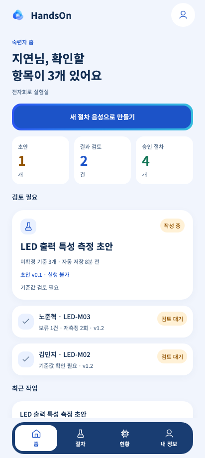
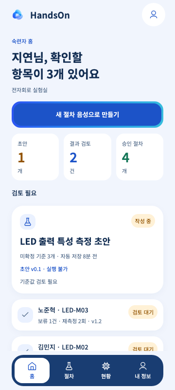

# E01 숙련자 홈 검증

2026-11-05, 개발용 합성 데이터와 Chromium 웹 화면으로 확인했습니다. Android는 로컬 에뮬레이터를 사용하지 않고 PR의 기존 `Maestro Android` CI에서 검증합니다.

## 디자인과 구현 범위

- 기준: 이슈 #7과 사용자가 첨부한 2091×13971 SVG의 E01 숙련자 홈.
- 첨부 원본 SHA256: `b5d16c5d63608b852f0463ef4dc03314cffd390876de0d90ff201161955162b9`.
- 기존 AppBar, Button, MetricTile, ProcedureCard, StatusBadge, SurfaceCard, BottomNavigation과 의미 토큰을 재사용했습니다. 선택한 환경 이름을 추가하고 실제 장치 연결을 확인하지 않았으므로 시안의 ‘로컬 연결’ 표시는 사용하지 않았습니다.
- 집계는 조회한 목록의 초안·승인·검토 대기 상태에서 계산합니다. 검토 완료 결과는 대기 건수에 포함하지 않습니다. 승인 전 초안에는 ‘실행 불가’를 표시하며 연구생 실행 경로를 추가하지 않았습니다.
- E02–E07 목적지는 식별자를 유지하는 진입 경계입니다. 해당 절차·결과를 현재 환경에서 다시 찾아 요약과 준비 중 안내를 표시하며, 음성 녹음·저장·승인·검토 완료를 수행하지 않습니다. 잘못된 식별자나 결과와 절차의 조합은 찾을 수 없음으로 안내합니다.

## 확인한 동작

Jest에서 집계와 상태별 목록, 최근 작업을 포함한 식별자 콜백, 로딩·빈 상태·오류에서도 새 절차 작성 유지, 재시도, 이전 환경의 늦은 응답 무시와 화면 복귀 후 재조회를 확인했습니다.

Playwright에서 412×920·360×800 화면으로 새 절차·초안 편집·결과 검토 진입과 홈 복귀, URL의 절차·결과 식별자, 승인 절차·검토 완료 필터와 환경 변경을 확인했습니다. 기존 역할별 진입 검사도 함께 실행합니다. 다른 worktree의 Metro와 포트가 겹칠 때는 `EXPO_E2E_PORT=8082 npm run test:e2e`로 분리할 수 있습니다.

타입·린트·포맷, `npm run test:ci`, `npm run doctor`, `npm run export:android`를 확인합니다. 실행 결과는 PR의 Checks에서도 확인할 수 있습니다.

| Chromium 412×920                          | Chromium 360×800                          |
| ----------------------------------------- | ----------------------------------------- |
|  |  |

## Android CI

`.maestro/expert-home-android.yaml`을 기존 `.github/workflows/maestro.yml` 실행 대상에 추가했습니다. `EXPO_PUBLIC_HANDSON_MAESTRO=1`로 빌드한 APK에서 숙련자 홈, 새 절차·초안·결과 진입, 시스템 뒤로 가기, 상태 필터와 환경 변경을 확인합니다. 캡처와 진단 로그는 PR의 `maestro-android` artifact에 남습니다. 위 이미지는 웹 캡처이며 Android 캡처가 아닙니다.

## 남은 확인

실제 서버의 현황 집계·목록·초안 재진입 계약, 사용자 이름, 장치 연결 상태와 E02–E07의 작성·승인·검토 처리는 후속 연동 범위입니다. 모의 조회 성공을 실제 연동 완료로 간주하지 않습니다. Android에서의 글꼴 확대와 보조기기 접근성은 별도 확인이 필요합니다.
